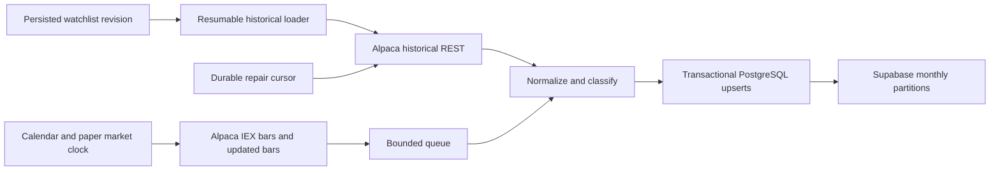

# Architecture

The monorepo starts with `components/market_data/`. Future frontend, backtesting,
strategies, risk, execution, and additional providers should be separate components.
Shared ingestion code serves both the persistent worker and the tools in `tools/`.

Provider-neutral domain models and ports cover instruments, historical pages,
streaming bars, calendars, and market clocks. Provider SDK objects do not enter
storage. Each series identifies provider/feed/instrument/interval/currency and
adjustment mode. Additional vendors share the time-series table but have distinct
series; ticker text alone never merges instruments across providers.

Initial configuration is SPY, QQQ, IWM, VXUS; one-minute raw USD IEX OHLCV, VWAP,
and trade count. IEX and SIP are different datasets. Alpaca Basic provides live
IEX access; its 15-minute restriction on recent consolidated history does not
turn IEX into delayed SIP. The deployed REST repair cutoff remains 15 minutes.
Changing feeds requires distinct series and an explicit history decision.

All timestamps are UTC bar-start times. Date-only CLI boundaries mean New York
midnight; intervals are half-open. Session classification uses America/New_York,
including DST and calendar early closes. Collectors run within 04:00–20:00 NY on
calendar trading days, with a 60-second preconnect and 90-second correction grace.
Actual bars depend on IEX trading hours and liquidity; no empty-minute bars are
manufactured.

While connected, a monitor refreshes the calendar every 60 seconds, independently
of arriving data. During regular-session calendar hours, a false market clock
pauses collection for an unexpected closure. A false clock during pre/post-market
is normal and does not block extended collection. Closed periods use 30, 60, 120,
240, then 300-second sleeps, capped at the next connection window. Closure
recognition depends on Alpaca updating its calendar/clock; it is not an independent
exchange emergency notification service. A halt in one instrument may produce no
bars without closing the whole market.

One database advisory lock owns the stream. During a rolling release, a new
revision can remain alive in standby for up to five minutes while the old owner
drains; it does not connect to the stream until ownership transfers. Its connection is separate from pooled
writes; loss of the lock is fatal. Bounded queues, batch upserts, graceful shutdown,
reconnect backoff, startup repair, and periodic reconciliation recover missed bars.
Repair runs every five minutes and revisits seven days every six hours. Completed
ranges are stored independently of observed bars, including successful empty ranges.

Updated streaming bars outrank initial stream bars. Eligible historical snapshots
outrank both; request-start timestamps prevent older snapshots overwriting newer
observations. These are latest revised bars, not a point-in-time revision archive.
Future backtests must account for this distinction and corporate actions.

References: [Alpaca plans](https://docs.alpaca.markets/us/docs/about-market-data-api),
[historical bars](https://docs.alpaca.markets/us/reference/stockbars),
[streaming](https://docs.alpaca.markets/us/docs/real-time-stock-pricing-data),
[clock](https://alpaca.markets/sdks/python/api_reference/trading/clock.html).
