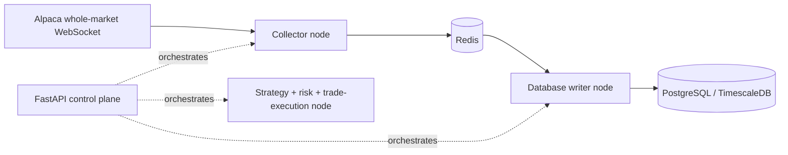

# Bagel platform plan

Updated November 9, 2026. This replaces the previous trading-platform and cloud
deployment plans. **The target topology below is not implemented or authorized
for implementation by the API restructuring work.**

## Goal

Build a scalable stock-trading platform that can ingest the entire US stock/ETF
market minute by minute and execute strategies against it. FastAPI is the
orchestration and control plane, not the eventual market-data or trading hot path.
Support long and short positions on completed one-minute bars or slower.

## Target runtime boundaries — future work

| Component | Responsibility |
|---|---|
| Control API | Validate operator requests, expose status, and orchestrate the other nodes. |
| Data collector | Listen to an Alpaca whole-market WebSocket and write observations to Redis. |
| Database writer | Periodically consume buffered observations from Redis and persist them to PostgreSQL/TimescaleDB. |
| Trading node | Combine strategy evaluation, risk checks including position sizing and limits, and trade execution. |

Each application node will have its own folder at the repository root and service
in the single root `compose.yaml`. Service-folder names, message contracts, Redis
delivery/acknowledgement semantics, persistence cadence, capacity, provider data
entitlements, and TimescaleDB adoption need separate design and authorization.
Do not assume Redis buffering alone provides replay, durability, or exactly-once
execution. Do not enable broker order submission without an approved execution
and risk design.

The trading node's input source and command/status transports are deliberately
unspecified until their contracts are designed. The planned separate operator UI
uses Next.js, MUI and Zustand; UI scaffolding remains deferred.

## Current implementation

- Root `api/` contains the HTTP application, settings, lifespan, dependencies,
  API-key security, response schemas, middleware, and versioned feature routers.
- Root `api/dockerfile` builds an API target and a compatibility collector target.
  Root Compose starts only the API and standard PostgreSQL 17.
- `market/` retains existing ingestion, immutable dataset exports, the durable
  research queue, strategies, backtesting, risk, simulated execution and portfolio
  accounting. This pass does not relocate or duplicate those engines.
- For now, API lifespan owns the existing offline research worker and optional
  ingestion integration. Compose forces ingestion, streaming and backfill off.
  Keeping this integration during the restructure is not the target topology.
- Local API configuration lives in `api/settings.py`, including existing `DB_*`
  settings. Shared connection setup remains in `market/database.py`, preserving
  SQLAlchemy `pool_pre_ping=True`, psycopg transactions and COPY.
- Business routes remain under `/v1/research`. `X-API-Key` authenticates versioned
  routes and `/metrics`; the required key comes from `BAGEL_API_KEY` at runtime.
  Health probes remain unauthenticated. The API is published only on loopback.
- Current research uses synthetic fixtures and simulated execution. No real
  trading, whole-market subscription, Redis service or TimescaleDB is added.

## API structure and development

`api/main.py` assembles the app. `api/routes/v1/router.py` includes feature routers;
each feature folder contains a `route.py`. Health and metrics are unversioned
operational routers. Application-wide middleware lives in `api/routes/`.
`api/schemas/` holds public contracts; `api/models/` is reserved for persistence
models without converting existing SQL repositories to an ORM.

Use direct Uvicorn startup with reload. Compose mounts only the `api/` and
`market/` source trees read-only, keeping secrets out of mounts and images. A
source edit restarts the app lifespan; workers must stop cooperatively and pools
must be disposed before replacement. Dependency and environment changes require
an image rebuild or container recreation respectively.

## Sequence and approval gates

1. **Restructure the API locally.** Preserve endpoint URLs, existing research
   behavior and database contracts; introduce the temporary shared API key and
   verify hot reload, health, authentication and synthetic research end to end.
2. **Design node boundaries separately.** Agree message schemas, completed-bar
   semantics, ordering, corrections, backpressure, replay, idempotency, worker
   ownership and capacity before implementing the collector/writer split.
3. **Validate ingestion locally when authorized.** Confirm provider entitlements
   and measured whole-market throughput. Decide Redis retention and persistence
   guarantees, database sizing and any forward-only TimescaleDB migration. Never
   manufacture missing market prices or silently mix provider feeds.
4. **Design and validate the combined trading node.** Establish strategy versions,
   risk limits, position sizing, durable order intents, duplicate prevention,
   broker reconciliation and stop controls before any paper or real execution.
5. **Review production independently.** Replace temporary shared-key access and
   local superuser use, define scoped service identities and permissions, measure
   cost and performance, and obtain explicit deployment approval.

Keep work on `dev`. Do not access market data, start local ingestion, import
history, modify hosted databases, deploy, merge to `main`, change the existing
collector schedule, or scaffold the UI without separate authorization. The
existing Supabase GitHub integration can make a merge to `main` a production
migration path. Existing hosted automation remains unchanged.

## Preserved research and data safeguards

Keep UTC/timezone handling, completed-bar timing, provider/feed/series identity,
bounded resource use, queue leases, cancellation and deterministic frozen inputs.
Latest revised history is not point-in-time market history; synthetic results
verify machinery, not strategy profitability. Credible research and trading need
explicit corporate-action, short-borrow, execution-cost and data-quality
assumptions. Do not use destructive capacity recovery as the future whole-market
retention design without a separately reviewed replacement.

See [local startup](../README.md#local-postgresql-stack),
[research operations](research-backend.md), [current architecture](architecture.md),
[database history](database.md), [security](security.md) and
[existing hosted operations](operations.md).
