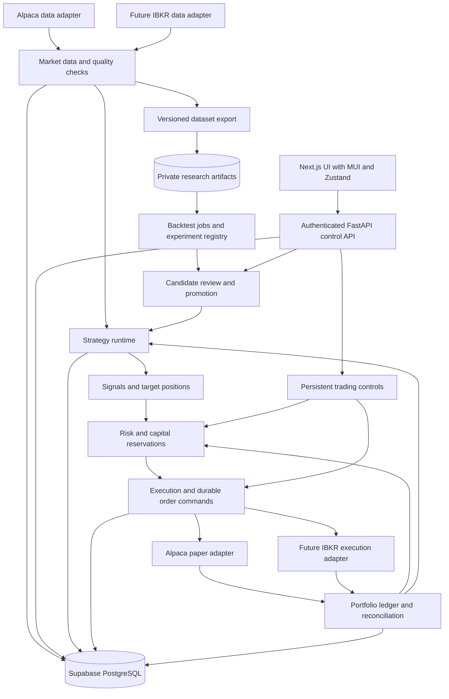

# Bagel trading platform plan

**Status:** Proposed architecture and delivery plan  
**Date:** November 3, 2026  
**Scope:** US equity/ETF long/short research through supervised paper trading, with a path to multiple accounts, brokers, and asset classes.

## 1. Recommendation

Build a modular Python platform around the existing market-data component. Keep
research, strategy decisions, risk, execution, and portfolio accounting separate
in code, while sharing a small set of explicit domain contracts. Deploy the
always-running trading worker separately from the API and research jobs.

The central configuration unit is a **deployment**:

> Immutable strategy version + parameters + data profile + broker account + capital allocation + risk policy.

A strategy must not know whether its input came from Alpaca or IBKR, or whether
its orders will be simulated or sent to a paper broker. Data selection and order
routing are separate decisions. Multiple deployments can use different providers
at the same time without changing strategy code.

Deliver the first complete workflow with one strategy and one Alpaca paper
account. Then enable concurrent deployments on different accounts. Model accounts
and deployments explicitly from the first release; defer sharing one account
between strategies until portfolio allocation and attribution are implemented.

## 2. Starting point, confirmed scope, and remaining defaults

The existing component is the completed ingestion foundation. These observations
come from repository code and deployment records, not a fresh production audit:

- Python 3.12, Poetry, PostgreSQL 17 on Supabase, and GCP deployment tooling exist.
- `components/market_data/` already separates provider ports, normalized domain
  models, Alpaca ingestion, storage, calendars, recovery, and observability.
- Series identity includes provider, feed, canonical instrument, interval,
  currency, and adjustment. Preserve this distinction across the platform.
- The initial watchlist is SPY, QQQ, IWM, VXUS, with raw USD one-minute IEX bars.
  Ingestion includes extended sessions; that does not require strategies to trade
  those sessions.
- The October 25 deployment record reports approximately 1.62 million bars and a
  313 MB database. These are historical measurements, not current capacity.
- Existing storage keeps the latest bar revision. It cannot reconstruct every
  value a live strategy would have observed historically.
- Capacity recovery can truncate and reload a shorter historical window. It
  currently refuses that reset when another source/feed has stored bars.
- Structured logs and health endpoints exist; alert delivery, strategies,
  backtesting, order submission, portfolio accounting, and a UI remain to build.

Confirmed requirements: the MVP trades US stocks/ETFs, supports both long and
short positions, and evaluates completed one-minute bars or slower. Options,
futures, forex, and crypto are future asset classes whose extension points must
be designed now. Execution below one minute is a long-range objective.

The table combines those confirmed requirements with remaining working defaults
such as whole shares, USD reporting, and regular-market-hours execution:

| Area | First paper MVP |
|---|---|
| Instruments | US stocks/ETFs, initially the existing watchlist |
| Trading | Long and short; whole shares, USD, regular market hours |
| Short availability | Initially broker-eligible easy-to-borrow instruments on a short-enabled margin account; other borrow workflows extend the same interface |
| Frequency | Completed one-minute bars or slower, including session-aware resampling |
| Order support | Market and limit DAY orders; explicit expiry and cancellation behavior |
| Holding period | Overnight holdings allowed; intraday-only strategies declare an exit policy |
| Research | Hundreds of versioned experiment runs, including parameter variants |
| Execution | One Alpaca paper account and one enabled strategy deployment |
| Operator | One authenticated owner, with viewer/operator roles in the access model |
| Automation | Operator selects candidates and explicitly enables paper deployments |

Options, futures, forex, crypto, hard-to-borrow locate workflows, sub-minute
strategies, automatic live-money promotion, and cross-broker smart order routing
are later delivery scope. Margin eligibility and risk checks required for short
selling belong in the MVP; the allowed gross exposure and any additional leverage
are explicit risk-policy decisions.

## 3. Architecture and runtime boundaries



Use a modular application with these process boundaries:

| Runtime | Responsibility | Failure/resource isolation |
|---|---|---|
| Existing ingestion worker | Provider connections, history, corrections, data health | Remains independently deployable |
| Trading worker | Scheduling, strategy runtime, risk, execution, reconciliation | Always running; one fenced owner per account |
| Research jobs | Dataset exports, batches, simulations, reports | Bounded CPU/memory and concurrency; no order credentials |
| Control API | Authenticated reads, validated commands, deployment management | Requests persist work; they do not own trading loops |
| Next.js web application | App Router pages, MUI components, Zustand client state, research and operations screens | Can restart without interrupting trading |

Initially, strategy, risk, execution, and reconciliation are modules inside one
trading worker. Their interfaces allow later extraction if workload or operating
needs justify it. Avoid one network service per module in the MVP.

Proposed additions to the repository:

```text
components/
  market_data/         # Existing component; extend its ports carefully
  trading_domain/      # Small common vocabulary and interfaces
  asset_rules/         # Instrument types, valuation, lifecycle, and financing rules
  strategies/         # Registry, implementations, indicators, evaluation
  backtesting/        # Replay, simulated broker, accounting, metrics
  risk/               # Policies, sizing checks, reservations
  execution/          # Order lifecycle and broker adapters
  portfolio/          # Ledger, projections, reconciliation
  orchestration/      # Schedules, jobs, deployments, worker ownership
  api/                # Authenticated control and query endpoints
apps/
  web/                # Next.js + TypeScript, MUI, Zustand operator application
```

Share identity, money/quantity types, clocks, and event envelopes. Keep business
logic in its owning component. Reuse existing canonical instrument IDs and series;
do not create a second security master. Move shared types only when a consumer
needs them, preserving current imports during migration. Provider SDK objects
stay inside adapters. Enforce import boundaries in CI.

## 4. Providers, connections, accounts, and configuration

### Independent configuration objects

| Object | Meaning |
|---|---|
| Provider connection | An authenticated integration, its environment, capabilities, and secret reference |
| Data profile | Source connection, feed, instruments, interval, session, adjustment, freshness and finalization rules |
| Broker account | Canonical account ID, execution connection, external account identifier, currency, permissions |
| Strategy version | Immutable code artifact, parameter schema, inputs, warmup and state schema |
| Strategy instance | A version plus validated parameters and instrument universe |
| Risk policy | Versioned sizing, exposure, loss, freshness, and operational constraints |
| Deployment | An instance bound to an account, data profile, allocation, risk policy, and environment |

One connection may expose multiple accounts. A deployment identifies its account
explicitly; never infer an account from a global environment variable. Each
account-scoped row and API command carries the canonical account ID. Unique
external identifiers include connection/environment scope.

Illustrative configuration, not a new executable format or implemented feature:

```yaml
deployment:
  id: spy-trend-paper-01
  mode: paper
  strategy_version: trend-following@sha256:<artifact-hash>
  parameters: {fast_window: 20, slow_window: 100}
  universe: ["<canonical-SPY-instrument-id>"]
  data_profile: alpaca-iex-1m-regular-v1
  execution_account: alpaca-paper-research-01
  allocation: {currency: USD, capital: "10000.00"}
  risk_policy: conservative-paper-v1
  desired_state: stopped
```

Allocation is a strategy budget within the account's actual capacity; it does not
create broker buying power. Store secret references and versions in configuration,
with values in GCP Secret Manager. Deployment revisions are immutable and record
who changed them. Apply changes through stop/reconcile/restart or an explicit safe
boundary. Reject stale UI edits using revision checks.

### Adapter contracts

Use small capabilities rather than one universal provider class:

- Data: `HistoricalBars`, `StreamingBars`, `InstrumentLookup`, `TradingCalendar`,
  plus optional `Quotes`, `CorporateActions`, and entitlement/health discovery.
- Execution: `AccountReader`, `OrderSubmitter`, `OrderReader`, `OrderCanceller`,
  `ExecutionEvents`, `ExecutionHistory`, `ShortAvailability`, and `MarginState`,
  plus `AccountActivities` where supported. Locate workflows are a later capability.
- Simulation: the same normalized order/account/event contracts, implemented by
  the backtest broker.

An adapter advertises supported assets, quantity steps, tick sizes, order types,
time-in-force, sessions, short/borrow support, margin state, account permissions,
identifier semantics, and recovery capabilities. Deployment validation checks
required capabilities before startup.
An unsupported feature fails explicitly; adapters must not silently substitute a
different order type, feed, or account.

Keep provider details in adapter state: Alpaca client-order identifiers, IBKR
contract identifiers, session/client/order mappings, authentication, pacing,
reconnect behavior, and raw status codes. Rate limits and connection limits may
be shared across accounts using the same login; manage those at connection scope.

### Supported evolution

1. Alpaca data + Alpaca paper execution.
2. Alpaca data + IBKR paper execution.
3. IBKR data + IBKR paper execution.
4. Parallel deployments across both providers and accounts.

The IBKR integration needs a feasibility spike before implementation: choose its
Web API or TWS/IB Gateway path, verify account eligibility, authentication and
session recovery, market-data subscriptions, historical coverage, and deployment
hosting. TWS uses a connection to TWS or IB Gateway; Web API access has its own
session requirements. These are operating differences behind the adapter, not
strategy changes. [IBKR TWS introduction](https://www.interactivebrokers.com/docs/tws-api/doc/introduction),
[Web API documentation](https://www.interactivebrokers.com/campus/ibkr-api-page/webapi-doc/),
[market-data limitations](https://www.interactivebrokers.com/docs/tws-api/doc/md/market-data-limitations).

Data failover and execution failover need different policies. An alternate data
feed must be explicitly validated and versioned. Never automatically resend an
uncertain order to another broker: the original may already have filled, and
cash/positions belong to separate accounts.

### Asset-class extension model

Keep **provider adapters** separate from **asset rules**. Adapters connect to a
vendor; asset rules describe an instrument's identity, order units, valuation,
sessions, funding, margin, and lifecycle. A new asset class must register those
rules and pass common strategy/backtest/execution/portfolio contracts. Reuse the
engines while adding the product behavior and data the asset actually requires.

Use a canonical instrument ID plus a typed instrument definition. The existing
instrument and mapping tables remain the identity anchor. Add validated typed
details when needed rather than relying on ticker text, a generic stock object,
or one table with every possible product field nullable.

| Asset rules | Future metadata and behavior to add |
|---|---|
| Equity/ETF — MVP | Shares, exchange/session, settlement currency, corporate actions, long/short accounting, borrow and margin eligibility |
| Options | Underlying ID, expiry, strike, call/put, multiplier/deliverables, exercise style, assignment/exercise, expiry settlement, premium and exposure/Greeks rules |
| Futures | Exchange and specific contract identity, expiry/roll policy, multiplier/tick value, initial/maintenance margin, variation settlement, delivery/expiry handling |
| Forex | Base/quote currencies, provider quantity/lot conventions, conversion marks, currency balances, sessions, financing/rollover, settlement rules |
| Crypto | Venue and base/quote asset identity, precision/minimum size, continuous calendar, venue outages/maintenance, custody/fees; derivatives get separate contract/funding rules |

Store signed position quantities and explicit quantity units. Keep price, quote
currency, settlement currency, reporting currency, and valuation conversion
separate. Do not assume all quantities are shares, all calendars use New York
equity hours, every contract has a multiplier of one, or every asset uses equity
cash-settlement and borrow mechanics. Preserve per-currency ledger balances;
convert with versioned, timestamped rates when producing combined reports.

Provide interfaces such as `InstrumentRules`, `SessionRules`, `ValuationModel`,
`MarginModel`, `FinancingModel`, and `LifecycleHandler`. Implement the equity/ETF
rules first and test dispatch with synthetic instrument fixtures. Real additional
asset support requires its own adapter capabilities, data coverage, accounting,
risk, and acceptance tests; an enum value alone does not enable trading.
Asset rules also supply risk exposure measures: a shared engine must not assume
that quantity times price captures an option's or derivative's full risk.

Keep strategy evaluation cadence separate from data event type and execution
latency. The MVP scheduler validates a minimum interval of 60 seconds and supports
session-aware aggregation to slower bars. Use explicit event/received/available
times and capability-based feeds so the shared vocabulary can later accommodate
quotes, trades, and shorter intervals. Sub-minute trading still requires a separate
design/benchmark for data coverage, ordering, throughput, broker behavior, and
latency; reducing a configuration value is not sufficient.

## 5. Market data and reproducible datasets

Retain current ingestion and add a consumer-facing dataset layer:

1. Expose bounded historical reads and scheduled bar evaluation through a
   provider-neutral `BarFeed`. Strategies do not query provider SDKs or tables.
2. Define data readiness by session, expected timestamps, required instruments,
   minimum warmup, known gaps, and a configurable arrival grace period. A bar's
   start timestamp is not the time its completed value became available.
3. Create durable evaluation records keyed by deployment revision and evaluation
   time. Save the exact input values/references before computing a decision.
   Late corrections update research data but do not repeat a completed live decision.
   Worker ownership generations are separate and must not change evaluation identity.
4. Distinguish initial live observations from historical repairs. Historical
   backfills must never trigger a burst of stale broker orders. After an outage,
   restore state and reconcile; explicitly decide whether the current evaluation
   remains eligible. Default to skipping expired trading opportunities.
5. Resample using exchange sessions, early closes, and explicit missing-bar rules.
   Never invent tradable prices or silently merge IEX, SIP, and IBKR series.

Export immutable, versioned Parquet datasets to a **new private research artifact
bucket** in GCS. The existing build-source bucket expires objects and must not
hold research history. Put manifests and checksums in Supabase; put large data,
equity curves, detailed simulated fills, and reports in object storage. Use local
cache and DuckDB/columnar reads in jobs so hundreds of runs do not repeatedly scan
the operational database. [DuckDB Parquet documentation](https://duckdb.org/docs/stable/data/parquet/overview).

Each manifest records source/feed and series IDs, instruments/mappings, date
bounds, session, adjustment, calendar and corporate-action versions, quality
report, extraction time, content hashes, object generations, and availability
semantics. Export with a consistent database snapshot or pinned immutable chunks;
an export spanning concurrent corrections must not mix undocumented revisions.

There are two distinct research guarantees:

- **Frozen revised history:** Repeatable experiments on the same exported latest
  values. This is the first research release and must be labeled accordingly.
- **Recorded live replay:** Decisions replayed from observations and arrival times
  captured prospectively. Add this capture before paper evaluation. It cannot
  reconstruct unavailable historical revision history retroactively.

Corporate actions are required for credible multi-year equity/ETF results. Add
splits, distributions/dividends, symbol changes, and delisting handling, with
explicit source and coverage. Keep raw tradable prices and economic adjustments
consistent: adjust holdings/cash at the event time; never apply both dividend
cash and total-return adjusted prices to the same P&L. Features using adjusted
data must use the declared causal adjustment policy. Use an eligible ETF baseline
to validate accounting. Until supported, label affected results exploratory and
block promotion where missing actions materially change the result.

Before broadening the universe, replace capacity-triggered destructive reloads
with a reviewed archive-and-retention policy. Preserve the current behavior until
that migration is deliberately implemented, but do not rely on it as the future
research retention mechanism. Pin datasets referenced by experiments and never
prune the order ledger through market-data retention. Plan capacity for bars,
indexes, WAL, audit tables, and projected growth; use measured costs to decide
whether to increase database capacity or retain a smaller hot window.

## 6. Strategy engine

Implement a versioned strategy interface whose inputs are a clock, bounded market
history/features, portfolio view, parameters, and optional persisted state. Its
output is a decision containing buy/sell/hold semantics, reason codes, desired
target quantities or weights, and the next strategy state.

Prefer target positions over unconditional repeated buy commands. The order
planner computes a delta against positions **and existing working orders**.
Positive targets represent long positions, negative targets represent shorts,
and zero represents flat. Normalize order intents into buy-to-open,
sell-to-close, sell-short-to-open, and buy-to-cover effects even if a broker
exposes only buy/sell. Submit positive order quantities with explicit side/effect.
For the MVP, a target reversal closes and confirms the existing side before
revalidating eligibility and opening the opposite side; reserve each step and
recheck the target's validity rather than assuming an atomic reversal.
`hold` means no target change; it must not implicitly cancel valid orders. Each
decision also declares validity/expiry and its instrument/data dependencies.

Strategy code is deterministic: no wall-clock reads, broker calls, database
writes, hidden random seeds, or credentials. Inject the clock and record seeds.
The same decision function and risk rules run in backtesting, recorded replay,
shadow mode, and paper trading; only data delivery and execution adapters change.
Simulator fills are still model assumptions, so matching logic does not imply
identical realized returns.

Shadow mode evaluates current data and portfolio state, saving hypothetical
intents and risk outcomes while order submission remains disabled. It checks
readiness and behavior before a candidate begins its paper forward test.

Start with a simple moving-average strategy that can exercise both long and short
targets, alongside buy-and-hold and cash benchmarks. Include deterministic
short-only and reversal scenarios as plumbing verification, not claims that these
are profitable candidates.

Persist strategy code/image digest, parameter hash, schema version, input snapshot,
signal, state transition, decision timestamp, and trace ID. Commit evaluation
completion and its resulting intent atomically. Repeated scheduling of the same
evaluation must not create a second intent. Checkpoint state and indicator warmup;
restart must reproduce the uninterrupted decision sequence before trading resumes.

The UI configures parameters and selects reviewed versions. New strategy code
enters through source control and CI, not arbitrary Python entered in the browser.
Research workers have read-only market-data access, scoped write access to their
results/artifacts, and no execution credentials.

## 7. Backtesting and strategy research

Build a deterministic event-driven simulator first because order timing, risk,
partial fills, and accounting must agree with the paper path. Use cached arrays,
batch feature computation, and processes/jobs to scale. Benchmark it before
adding a separate vectorized screening engine; any later fast screen must send
finalists through the authoritative simulator.

### Experiment specification and execution

Every run records strategy/version/parameters, immutable dataset, universe,
calendar, starting capital, account assumptions, warmup, time splits, execution
and cost model versions, historical short-availability/financing assumptions,
risk policy, code/dependency/image hashes, random seed, and parent experiment.
A batch is an explicit list/search space of such runs.
A batch may span different strategy implementations as well as parameter
variants; every strategy uses the same runner contract. Refinement creates a
new version or parameter set linked to its preceding research record.

Support queue/start/cancel/retry, progress and heartbeat, bounded attempts,
checkpointing where useful, result comparison, tagging, and artifact download.
Use content hashes to reuse identical completed work deliberately, while retaining
new run attempts and their provenance. Retry a failed task without mixing partial
outputs into a completed result. Finalize its artifact manifest only when complete.

Start with a benchmark of **100 parameter runs over the current five-year
four-instrument dataset**. Measure runtime, peak memory, dataset download,
database load, and cost per batch. The initial four instruments are plumbing
coverage, not adequate evidence for every strategy family. Bound concurrency
according to measured worker memory and provider/database budgets; do not promise
a completion time before this benchmark.

### Simulation fidelity

- An order can only use information available at its recorded decision time.
  Its simulated execution must occur after that time plus modeled latency. With
  minute bars and an arrival grace period, the immediately following minute's
  open may already have passed; choose a later executable bar boundary explicitly.
- Specify spread, slippage, commissions/fees, participation limits, partial fills,
  limit-order non-fill, expiry, rejected orders, and market closures. A touched
  high/low alone does not establish queue priority or a guaranteed limit fill.
- Treat OHLCV fills as approximations and report cost/latency sensitivity. Without
  quotes or an order book, do not claim quote-level execution realism.
- Handle simultaneous signals deterministically and compete for the same simulated
  cash using the account risk rules. Apply quantity/tick rounding and allocations.
- Include split/dividend accounting and distinguish economic returns from the
  paper broker's cash behavior. Log end-of-test positions and mark-to-market.
- Model short proceeds, collateral/buying power, borrow costs, margin interest
  where applicable, dividend payments in lieu, price gaps, margin stress, and
  broker-driven buy-ins/recalls through explicit scenarios. Proceeds from a short
  sale do not create unrestricted strategy capital. Report long/short P&L and
  gross/net exposure separately.
- Use timestamped historical short eligibility and borrow rates where available.
  Today's shortability cannot establish historical availability. If those records
  are absent, record declared eligibility/cost scenarios, stress them, and flag
  results as conditional. Candidate review must explicitly resolve that limitation;
  never silently assume unlimited borrow at zero cost. Capture availability and
  costs prospectively before paper evaluation.
- Test missing data, renames, early closes, and unavailable instruments. Broader
  equity universes need point-in-time membership and delisted instruments; a
  present-day universe must be labeled for survivorship bias.

### Evaluation and promotion

Use chronological train/validation/test periods and walk-forward evaluation.
Fit preprocessing on training periods only; purge/embargo overlaps where holding
periods or labels cross split boundaries. Keep a final holdout out of tuning.
Once inspected, it is no longer an untouched holdout for subsequent selection.

Store all attempted variants, including failures and discarded runs. Hundreds
of trials increase selection bias; inspect parameter stability, market regimes,
and cost sensitivity, and include a multiple-testing diagnostic when ranking
large searches. Optimize a predeclared objective subject to risk constraints,
rather than selecting the largest in-sample return.

Report total/annualized return where meaningful, daily-equity Sharpe/Sortino with
declared annualization, maximum drawdown and duration, volatility, turnover,
exposure, trade count, win rate, profit factor, cost sensitivity, and returns
relative to benchmarks. State conventions for cash flows and risk-free rate;
handle short/empty samples without fabricated metrics. Compare performance with
matching cash, buy-and-hold, and equal-weight baselines.

Promotion lifecycle:

```text
draft -> validated -> backtested -> candidate -> shadow -> paper -> retired
```

Promotion creates an immutable review record, not a mutable flag on source code.
Before paper enablement, require reproducible artifacts, data-quality eligibility,
out-of-sample results, stable parameters, cost stress, a declared minimum sample,
and a configured risk policy. Set the actual numerical return/drawdown thresholds
before searching; no universal threshold is assumed in this plan. Operational
correctness and research performance are separate gates. Live trading is a
separate later release with its own explicit enablement.

## 8. Risk management and order planning

Run risk checks centrally for every order, including exits and retries. Separate
target sizing from approval: strategies request exposure; the risk engine
approves, reduces under an explicit policy, or rejects with reason codes.

Initial controls:

| Scope | Checks |
|---|---|
| Order | Valid instrument, supported type/session, quantity/tick size, max notional, fresh valuation, price-deviation band |
| Position | Separate long/short quantity and notional limits, concentration, explicit open/close effect, reserved working reductions and short capacity |
| Deployment | Allocated capital, concentration, turnover/order-rate limits, daily loss and drawdown policy |
| Account | Cash/settled-funds constraints, broker buying power, gross/net exposure, initial/maintenance margin, margin buffer, short permissions and open orders |
| Platform | Global/account/deployment halt, stale account state, data outage, reconciliation discrepancy |

Require finite, explicit limits before enabling a deployment, including separate
long/short exposure, maximum gross exposure, and a minimum margin buffer. Support
short selling in the MVP on eligible accounts; do not equate short permission
with permission to consume all broker-offered leverage. Use broker-reported
restrictions and account capabilities rather than hardcoding regulatory
thresholds that can change.

Before a short opening or increase, verify account permission, instrument
shortability, fresh borrow availability, order eligibility, buying power, and
projected margin. Initially permit easy-to-borrow instruments and reject unknown
or unsupported availability; defer hard-to-borrow locate acquisition to a later
capability. Refresh eligibility before submission and after relevant broker
changes. A shortability flag is not a guarantee of a future fill or continued borrow.
Monitor existing shorts for borrow-status changes, recalls/buy-ins, financing
costs, and maintenance-margin deterioration; persist and alert on broker activity
and reconcile resulting position changes.

Alpaca's current asset API exposes `borrow_status`; normalize the provider's
current contract behind `ShortAvailability` rather than designing around the
deprecated `easy_to_borrow` field. Validate the pinned SDK/API behavior during
implementation. [Alpaca short-selling documentation](https://docs.alpaca.markets/us/docs/margin-and-short-selling),
[asset borrow-status changelog](https://docs.alpaca.markets/us/changelog/2026-06-05-borrow-status-6b96a5a).

Declare the valuation source and a conservative price buffer for sizing. If a
policy needs a spread or executable bid/ask check, require the quote capability
and entitlement explicitly; a minute-bar close is not a current executable quote.
Record whether those quotes cover IEX or consolidated markets.

Calculate exposure using filled positions plus worst-case outstanding orders and
unresolved submissions, including activity external to Bagel. Broker buying power
may already reserve acknowledged orders: subtract additional local unacknowledged
reservations without double-counting broker commitments. Keep both sources and
the valuation timestamp visible. Opening shorts reserve buying power, and short
sale proceeds remain subject to account collateral/margin constraints. A pending
long sale or cover does not free its corresponding commitment before confirmation.
Measure gross exposure as the sum of absolute marked exposures; netting long and
short amounts must not bypass gross or margin limits.

Serialize approval under an account lock/transaction: read the reconciled snapshot
and reservations, evaluate limits, reserve capital/shares, persist the risk
decision, and enqueue the approved order command atomically. Tie approval to
account/config versions and an expiry. Revalidate kill state, freshness, remaining
reservation, and changed account state immediately before broker submission.

Release reservations only through confirmed fills/terminal states or a reconciled
resolution. A network timeout or elapsed local TTL does not prove an order absent.
Loss limits pause new exposure; allow only explicitly classified reductions that
cannot increase absolute risk, cross through zero, or open the opposite side.
For a long, that is a bounded sell-to-close; for a short, a bounded buy-to-cover.
Reserve reducible quantities across working orders to avoid over-closing.
Unknown/stale positions require broker verification before an automatic reduction
can be considered safe.

For the single-account MVP, account and deployment limits are sufficient. Add
platform-wide reservations and exposure checks before allowing aggregate limits
to authorize concurrent multi-account trading. Informational dashboards alone
do not enforce a shared budget.

## 9. Execution engine

Use a durable order state machine, with provider raw status retained separately:

```text
planned -> risk_rejected
planned -> approved -> pending_submit -> acknowledged -> partially_filled -> filled
                               |              |                |
                               v              +-> rejected     +-> cancel_requested
                         submit_unknown       +-> expired               |
                               |              +-> cancel_requested      v
                               +-> reconcile                      canceled / filled
```

Cancellation is a request, not a terminal state; fills can race with it. Persist
order intent, normalized broker request, stable client identifier, account and
deployment IDs, reservation, and a submission attempt **before** calling the broker.
Persist acknowledgments, fills, cancel events, rejections, and corrections.

If submission times out after the broker might have accepted it, mark
`submit_unknown`, keep its reservation, and reconcile by the adapter's supported
identity/history mechanism. Do not blindly generate another order ID. Alpaca
supports client-supplied order identifiers and order lookup; this aids recovery
but does not make the network/database transaction atomic.
[Alpaca order documentation](https://docs.alpaca.markets/us/docs/orders-at-alpaca).

Normalize streaming order events and use periodic REST/history reconciliation as
a repair path. Deduplicate fills by account/provider execution identity, with
explicit support for corrections/busts; deduplicate status messages separately.
Handle out-of-order events without undoing confirmed fills. Unsupported or
ambiguous broker states pause the affected account for reconciliation.

The paper MVP supports submit, status, cancel, expiry, and partial fills. Defer
automated replace/bracket/complex orders; a later cancel-and-replace operation
must wait for cancellation resolution and recompute the remaining quantity.
Persist order validity so an intent cannot accidentally execute after its signal
has expired or after the market closes.

Carry the normalized position effect throughout submission, fills, and recovery.
The adapter maps it to broker-specific short-sale and closing semantics and
reports borrow/margin rejections with reason codes. A cover must not accidentally
open a long, and an intended long close must not accidentally open a short.
Treat broker-originated forced closes, recalls, and buy-ins as external account
events requiring reconciliation, not as fills generated by a new strategy signal.

Alpaca paper fills use a simulation that omits several live-market effects and
can differ from results generated from the IEX signal feed. Treat paper operation
as a forward test of behavior and model differences, not proof of live fill
quality. [Alpaca paper-trading specification](https://docs.alpaca.markets/us/docs/paper-trading).

## 10. Portfolio state and broker reconciliation

Maintain an append-only activity ledger and rebuildable account/position
projections. The broker is authoritative for actual account cash, buying power,
orders, and held positions; Bagel is authoritative for strategy intent,
allocations, provenance, and its operational decisions.

Track fills, fees, cash transfers, splits, dividends, borrow charges, financing,
payments in lieu, forced covers/buy-ins, adjustments, and corrections.
Ingest broker account activities where available; create explicit unexplained
adjustment records where they are not. Do not silently overwrite a position and
lose why it changed. Keep external/manual activity distinct from strategy fills.

Produce account positions, available capital, reserved capital, realized and
unrealized P&L, cost basis, daily equity, drawdown, and cash-flow-adjusted returns.
Choose a declared research cost-basis convention; display broker cost basis and
P&L separately when conventions differ. Track signed positions, restricted short
proceeds, margin utilization, and long/short P&L separately. Mark a short liability
consistently as prices rise/fall; cash received on opening is not a profit.
Show mark source/time and unrealized P&L staleness. Alpaca's paper specification
omits dividends and borrow fees, so maintain model-imputed costs separately from
broker-posted activity, with a documented bridge between economic returns and
broker-paper cash returns. [Paper-trading assumptions](https://docs.alpaca.markets/us/docs/paper-trading).

Reconcile at startup, after reconnect, after uncertain submissions, periodically
during operation, and at session end. Start with a configurable 30–60 second
account sweep, adjusted to provider limits; streaming events provide faster updates.
Use overlap windows for fills/history and idempotent ingestion.

A reconciliation result records snapshot times, completeness/watermarks,
differences, resolutions, and tolerated rounding. Broker endpoints may not form
an atomic snapshot: merge fills arriving during the sweep, repeat unstable reads,
and avoid interpreting a transient ordering difference as a confirmed position
change. Block new risk while material discrepancies remain unresolved.

On restart: acquire ownership, load outstanding/uncertain orders and checkpoints,
reconnect, reconcile account and history, rebuild state, warm strategies, validate
data readiness and controls, then resume only if the persisted state allows it.
An unexpected paper-account reset/recreation creates a new account epoch and
requires review; it must not erase old experiments or mix old and new equity.

## 11. Durable coordination and database design

Use PostgreSQL transactions, a small durable work queue/outbox, and consumer
checkpoints initially. Do not introduce Kafka or Redis before a measured need.
Notifications can wake workers, but polling and durable records must recover
missed notifications.

Each work item records its type/version, payload reference, scope, trace ID,
idempotency key, available time, attempt count, lease owner/expiry, and terminal
outcome. Claim bounded batches with row locking, retry transient failures with
backoff, dead-letter persistent failures, and require explicit replay decisions
for trading commands. Research retries and expired trading intents have different
semantics. Use a logical consumer checkpoint/receipt per subscriber; a single
global processed flag cannot represent multiple consumers.

Guarantee durable at-least-once processing with idempotent business transitions;
do not claim exactly-once effects across a broker API and PostgreSQL. Long-running
jobs renew leases. Account ownership uses the existing dedicated-session locking
pattern plus a generation/fencing value checked by mutations. A worker that loses
ownership stops submitting immediately. A broker request already in flight may
still complete; the next owner must reconcile it before sending new orders.

Suggested table families, split into migrations by milestone:

| Schema | Core records |
|---|---|
| `market_data`, `ingestion` | Existing instruments/series/bars, ingestion controls; typed instrument extensions, quality, corporate actions, timestamped short availability |
| `platform` | Connections, accounts, data profiles, deployments/revisions, risk policies, ownership generations |
| `research` | Strategy versions/instances, datasets/manifests, experiments, run attempts, summaries, promotions |
| `trading` | Evaluations/state, signals/targets, risk decisions, reservations, order intents/orders/events, fills |
| `portfolio` | Ledger entries, signed positions, borrow/financing activity, account/equity/margin snapshots, reconciliation runs/differences |
| `operations` | Jobs/outbox, consumer receipts, trading controls, alerts/incidents, operator audit |

These are conceptual ownership groups, not a requirement to create every table
before the first vertical slice. Account-scoped tables include account ID and
deployment ID where attributable. Enforce foreign keys, environment consistency,
unique evaluation/order/fill identities, and legal state transitions. Use UTC,
Decimal for live money/quantities, and explicit currency; define tolerances when
research analytics use floating-point arrays.

Retain original events and append corrections. Build query-oriented projections
for the UI. Keep high-volume research traces outside Postgres, prune delivered
transient work under a documented retention policy, and retain ledger/audit
history independently. Do not stream every bar to every browser.

Keep backend schemas private with scoped database roles and RLS/grants. Separate
ingestion, research, API, and execution privileges; the current ingester role
must not gain order access. Version schema changes using the existing Supabase
migration/CD workflow, with compatible application rollouts.

## 12. Monitoring, controls, and recovery

Use structured logs with event name, severity, timestamp, trace/evaluation/order
IDs, deployment/account/connection IDs, and sanitized error codes. Avoid secret
values and unrestricted raw broker payloads. Bound metric label cardinality:
order IDs belong in logs/traces, not Prometheus labels.

Monitor market-data age/gaps, evaluation lag, worker heartbeats, queue age,
broker/session connectivity, submissions awaiting resolution, rejection rates,
fills and slippage, reserved capital, long/short and gross/net exposures, borrow
status changes, financing, margin headroom, drawdown, reconciliation age and
drift, database capacity, and research backlog/cost. Track data health per session
and source; a closed market or sparse IEX minute is not itself a platform outage.

Configure one real notification destination before paper enablement. Test alert
delivery and recovery, deduplicate incidents, and notify on meaningful failures
or required action. Keep the destination configurable. This plan does not send
messages or configure a destination.

### Trading controls

Provide persistent controls at global, account, and deployment scope:

| Action | Behavior |
|---|---|
| Pause new exposure | Stop risk-increasing submissions; keep ingestion, status processing, and reconciliation running |
| Halt and cancel | Block new strategy submissions and request cancellation of the selected scope's working orders |
| Flatten | Separate explicit action: reconcile holdings, resolve conflicting orders, submit reductions, track residual exposure |
| Resume | Explicit audited action after readiness checks; never automatically clears a manual halt |

The prominent UI kill switch performs **halt and cancel** for Bagel-managed orders.
Show external/manual orders separately; canceling those requires an explicit
account-wide scope. The UI displays requested state and observed completion,
including in-flight submissions, unconfirmed cancellations, and remaining positions.
Never display "safe" simply because a halt request was accepted.

Persist a halt generation immediately; approval and submission both check it.
Serialize command acceptance with submission authorization so commands queued
before the halt cannot escape afterward. Requests already in flight can still be
accepted or filled; discover and cancel them as they become visible. A separately
requested flatten operation uses a reduction-only control path while strategy
submissions stay halted and all applicable risk checks remain active. Flattening
may be impossible during an instrument trading halt, closure, broker outage,
or absent liquidity.

If the database/control state becomes unavailable, the execution worker stops
new submissions and new risk. Keep a documented broker-native emergency route
for existing orders. Provide an authenticated operator CLI with the same audited
commands so UI failure does not remove the control path. Distinguish pausing
strategy evaluation from halting already-approved order submission.

Initial engineering targets to validate under the selected deployment conditions:

- Persist an available control API's halt request within two seconds and expose
  any broker cancel still pending; this is not a guaranteed broker cancellation time.
- During normal regular-session operation, investigate data/evaluation lag beyond
  90 seconds; set final thresholds from observed IEX arrival distributions.
- Pause new exposure when account reconciliation exceeds its configured freshness
  budget, initially two minutes, or when an order outcome is ambiguous.
- Recover from worker termination without duplicate intents/fills or lost manual
  halt state, as demonstrated through deterministic fault tests.

Define backup/export retention and run a restore drill before unattended paper
operation. Do not assume a specific Supabase plan provides the required recovery
window. Record recovery-point/time targets after measuring restore and broker
history replay; neither a new worker nor an object copy alone proves recovery.

## 13. Operator UI and control API

The confirmed UI stack is **Next.js + TypeScript, Material UI (MUI), and Zustand**.
FastAPI remains the Python control API. Each layer has a specific responsibility:

| Layer | Responsibility |
|---|---|
| Next.js App Router | Routes, layouts, authenticated page rendering, loading/error boundaries, and server/client component composition |
| MUI | Shared theme/tokens, navigation, forms, tables, dialogs, alerts, and responsive accessible components |
| Zustand | Typed client-side state for account/environment selection, filters, experiment comparisons, configuration drafts, and UI preferences |
| FastAPI | Authorized queries and durable commands for research, deployments, risk, execution, portfolio, and operational controls |

Use Server Components for suitable initial reads and page composition, with Client
Components for interactive controls, charts, polling, and Zustand consumers.
Account-sensitive live reads have explicit freshness rules and do not use shared
or static caches. Serve the web application and `/v1` API through the same public
origin; a reverse proxy or thin Next.js route handler forwards API requests with
the user's identity. FastAPI validates identity and permissions on every request.
Next.js owns presentation/session integration; trading decisions, order state,
and background work remain in Python services and workers.
[Next.js server/client components](https://nextjs.org/docs/app/getting-started/server-and-client-components),
[FastAPI deployment concepts](https://fastapi.tiangolo.com/deployment/concepts/).

Configure MUI's App Router cache provider and theme provider using its supported
Next.js integration, with matching pinned dependency versions. Keep trading status
colors, account/environment banners, density, typography, and control dialogs
consistent across screens. Verify server-rendered styles and hydration before
adding the first research screen.
[MUI Next.js integration](https://mui.com/material-ui/integrations/nextjs/).

Create feature-scoped Zustand stores through client providers, with isolated
instances during server rendering and matching initial client state. Server
Components do not read or mutate a shared store. Persist only selected UI
preferences; keep credentials, risk policies, positions, order status, and kill
state authoritative in their backend systems. Reset account-specific drafts and
pending UI state on account/environment changes and clear user-scoped state on
sign-out. Typed API reads own their fetched snapshots, freshness, and refresh
lifecycle; command success comes from the API's observed result. Scope responses
by user/account/environment and discard stale in-flight results after a switch.
[Zustand Next.js guide](https://github.com/pmndrs/zustand/blob/main/docs/learn/guides/nextjs.md).

Use Supabase Auth for sign-in. The API validates token signature, issuer, audience,
and expiry and checks server-owned operator/account permissions on every action.
Keep broker/database secrets server-side; do not base authorization on editable
user metadata. Use restricted signup for the initial owner account and require
strong authentication for trading controls.
[Supabase JWT documentation](https://supabase.com/docs/guides/auth/jwts).

| Screen | Monitor | Maintain/control |
|---|---|---|
| Overview | Components, data/broker freshness, accounts, equity/exposure, active alerts | Global kill control, drill into failures |
| Market data | Feed, coverage, quality, gaps, history floor, storage | Watchlist/data profiles, bounded repair/export jobs |
| Strategies | Versions, schemas, parameters, lifecycle, evaluation explanations | Create instances, compare versions, retire |
| Research | Dataset lineage, batch progress, leaderboard, charts, trades, benchmarks | Launch/cancel batches, filter/compare, mark candidates |
| Deployments | Strategy/account/data bindings, desired versus observed state | Validate, enable paper, pause, revise, resume |
| Accounts/portfolio | Signed positions, cash, reservations, orders, fills, long/short economic/broker P&L, borrow costs | Reconcile, investigate drift, scoped halt/flatten |
| Risk | Long/short and gross/net limits, borrow eligibility, margin headroom, blocked signals and reasons | Version policies and allocations, inspect changes |
| Operations | Heartbeats, jobs, incidents, audit and control completion | Retry eligible work, acknowledge incidents, inspect logs |
| Connections | Provider/environment/account mappings, capabilities, last success | Validate integration, manage secret references |

Persist filters and always show environment/account context, source timestamps,
staleness, and data/model limitations on relevant results. Charts include equity,
drawdown, benchmark comparison, trade annotations, exposure, and costs. Use a
common experiment specification for UI and CLI research runs.

Begin with bounded polling, pagination, and a status feed. Optional Realtime/SSE
updates only prompt a state refresh; a reconnect reloads authoritative state.
Supabase Realtime does not guarantee delivery of every change, so it must not
carry the sole execution/kill command path.
[Supabase Realtime delivery guidance](https://supabase.com/kb/troubleshooting/realtime-postgres-changes-troubleshooting).

Illustrative API groups:

```text
GET  /status, /connections, /accounts, /accounts/{id}/portfolio
POST /datasets/exports, /experiments, /experiment-batches
GET  /experiments/{id}, /experiments/{id}/artifacts
POST /experiments/{id}/cancel, /candidates/{id}/promotions
POST /deployments, /deployments/{id}/validate
POST /deployments/{id}/enable-paper, /deployments/{id}/pause
POST /trading-controls/halt, /trading-controls/resume
POST /accounts/{id}/reconcile, /accounts/{id}/flatten
GET  /orders, /risk-decisions, /alerts, /audit-events
```

Each listed path is relative to `/v1`. Commands accept idempotency keys, validate
scope and config revision, and return durable operation IDs. Separate requested,
applied, failed, and partially completed states. Audits include actor, request,
reason, prior/new revision, and final outcome. High-impact account actions show
the exact scope and holdings/orders affected before submission.

## 14. Multi-strategy and multi-account behavior

**First release:** One deployment per account. Enforce that restriction with a
database constraint and deployment validation; schema flexibility alone does not
make concurrent strategies safe.

**Next release:** Multiple deployments on distinct accounts. Share ingestion and
research data, but isolate account ownership, credentials/permissions, orders,
cash, reconciliation, limits, P&L, and failure controls. A global halt affects all
accounts; an account problem pauses only that account unless a global rule is
breached. The same strategy version may run with different parameters/accounts.
An account worker may host several account loops; fencing and scheduling are
scoped by account, not by process.

**Later:** Multiple strategies sharing one account. Introduce virtual subportfolios,
capital allocation, target aggregation/netting, deterministic conflict resolution,
and fill/fee attribution before removing the one-deployment restriction. Only the
account allocator sends net orders; strategies must not independently race to
trade the same holdings. Virtual cash and attributed positions must reconcile to
the actual account, including unattributed external activity.

Combined dashboards may aggregate performance and exposure, but cash/buying power
cannot move implicitly across broker accounts. Correlated strategies may share
risk even when accounts differ; add cross-account exposure/concentration policies
and combined backtests before treating separate account results as diversified.

## 15. Delivery plan and acceptance gates

Use vertical slices, bringing the UI forward with each milestone. Do not wait
until every backend module is complete to build the operator experience.

| Milestone | Deliverables | Acceptance gate |
|---|---|---|
| M0: Foundation review and contracts | Confirm remaining defaults; component boundaries; asset-rule and account/data/deployment contracts; capacity/archive decision; adapter fixtures | Existing ingestion tests stay green; contracts preserve identity, signed positions, asset-rule dispatch, and account isolation |
| M1: Reproducible research slice | Immutable dataset export, long/short baseline strategy, simulator, short financing/margin scenarios, accounting, run registry, Auth/FastAPI, Next.js shell with MUI theme and Zustand stores, initial research screen | Repeated run matches pinned outputs; no future-data use; accounting/reversals match hand calculations; UI hydration and account-scoped state checks pass |
| M2: Batch research and selection | Search spaces, bounded job scheduling, comparison UI, chronological validation, promotion records | 100-run benchmark measured; cancellation/retries do not corrupt results; one candidate has a complete, reviewable research record |
| M3: Account state and operational controls | Alpaca read-only account/borrow/margin adapters, ledger/reconciliation, long/short risk and reservations, ownership, kill controls, account/risk UI | Ineligible shorts and margin breaches block opening risk; restart, external trades, stale snapshots and reservations reconcile; alert and halt drills pass |
| M4: First paper MVP | Alpaca long/short order adapter, shared strategy runtime, shadow mode, controlled paper enablement, order/control UI | Long-open/close and short-open/cover workflows reach reconciled P&L; reversals, ambiguous submits and partial-fill/cancel races recover; manual halt survives restart |
| M5: Concurrent accounts and second provider | Multiple separate-account deployments, aggregate risk enforcement, IBKR spike/adapter, provider capability UI | Two deployments on different accounts cannot spend or mutate each other's state; adapter contract/recovery tests pass; mixed-provider deployment demonstrated |
| M6: Later expansion | Shared-account allocator, additional assets/orders, stronger optimization, eventual live enablement | Separate design/release gates for each new operating capability |

M1 and M2 establish the research workflow. M3 and M4 complete the first paper MVP.
M5 fulfills concurrent deployments across separate accounts/providers. Complete
M0's identity and configuration decisions up front even though the second adapter
ships later. M3's read-only integration can progress alongside M2 once contracts
stabilize. Dates and effort estimates follow the M1/M2 benchmark and IBKR spike;
this plan does not assume a team size or delivery deadline.

Before M4 enablement, run shadow evaluations and a configured supervised paper
period covering multiple sessions and operational drills. Before unattended paper
operation, require a declared observation window and sample size, delivered alerts,
restore verification, no unresolved material reconciliation drift, and a reviewed
incident runbook. A short profitable interval is not the acceptance criterion.

## 16. Verification strategy

Add tests around failure boundaries and financial invariants, building on existing
domain/workflow/PostgreSQL tests:

- Deterministic strategy/replay tests, warmup and availability-time checks,
  session/DST/missing data, and restart state equivalence.
- Hand-calculated simulator cases for cash, fills, fees, splits/dividends,
  short proceeds and P&L, borrow/financing/payment-in-lieu costs, margin stress,
  drawdown/returns, limit non-fills, and stale marks.
- Adapter contract fixtures for identifiers, unsupported capabilities, decimal
  normalization, short eligibility, borrow-status changes, margin permissions,
  rate limits, and reconnect/history recovery.
- Signed-target and order-effect tests for opening/covering shorts, crossing zero,
  partial-cover races, forced buy-ins, and unknown historical borrow availability.
- Synthetic typed-instrument and asset-rule dispatch tests proving the shared
  contracts do not assume share units, one-times multipliers, USD-only balances,
  or a single equity calendar. Enable no new asset class through these fixtures.
- Transactional database tests for duplicate evaluations/fills, account locking,
  reservations, lease/fence takeover, halt races, and projection rebuilds.
- Fault injection at the broker boundary: accepted request followed by timeout,
  lost acknowledgment, duplicate/out-of-order events, partial fill while canceling,
  external activity, database outage, broker disconnect, and worker termination.
- API authorization/account-isolation tests and UI checks for stale state,
  invalid configuration, command progress, paper/environment context, and controls.
- Next.js/MUI server-rendering and hydration checks, Zustand instance isolation,
  account/environment switches, stale-response rejection, and sign-out cleanup.
- One gated paper end-to-end smoke workflow, with explicit test account and limits;
  ordinary CI uses broker fakes and cannot place real orders.

Financial invariants include no duplicate economic fills, no unreserved approved
exposure, balanced cash/position ledger transitions, no orders from historical
repair, no account cross-contamination, and no restart that clears a manual halt.
Track research performance regressions separately from correctness checks.

## 17. Proposed decisions, alternatives, and revisit triggers

| Decision | Why now | Tradeoff / revisit trigger |
|---|---|---|
| Python modules plus separate workers | Reuses existing code; shares strategy/risk logic | Extract services when measured resource or ownership needs demand it |
| PostgreSQL durable work/outbox | Transactions align intent, reservations, and work | Adds queue maintenance; consider a dedicated broker when backlog/fan-out exceeds budgets |
| Parquet/object storage plus small SQL metadata | Protects operational DB from research volume | Adds artifact lifecycle work; consider a warehouse when cross-dataset analytics grow |
| Event-driven simulator as authority | Exercises order/accounting behavior consistently | Slower than pure vectorization; optimize after the batch benchmark |
| Separate data, execution, and asset-rule interfaces | Supports mixed providers and future asset classes | Requires explicit capability, valuation, and lifecycle validation |
| One strategy per account initially | Gives clear capital ownership and P&L | Uses more accounts; shared accounts require allocator and attribution work |
| Next.js + MUI + Zustand with FastAPI | Confirmed UI stack; shared components, explicit client state, and Python control contracts | Operate the Next.js runtime; verify SSR/hydration and keep generated API types in sync |
| GCP runtimes plus Supabase | Builds on current deployment | Cross-cloud latency/egress and IBKR session hosting need measurement |

Implementation should price additional infrastructure/data requirements against
the chosen universe, retention, concurrency, and recovery needs.

## 18. Product decisions to resolve before implementation

1. Confirm remaining defaults for regular-session execution, overnight holdings,
   whole-share sizing, and USD reporting. US stocks/ETFs, long/short support, and
   completed one-minute bars or slower are already confirmed.
2. Choose the first strategy family and a predeclared research objective, capital
   budget, long/short and gross exposure limits, margin buffer, drawdown/loss
   limits, and minimum evaluation sample.
3. Set an initial research compute/storage and market-data budget; decide when
   IEX is adequate and which studies require consolidated or alternate data.
4. Confirm how many separate paper accounts should run concurrently in M5 and
   when IBKR capability is needed. Brokerage account availability is a provider
   constraint, not something configuration can manufacture.
5. Choose alert destination and operator coverage, and define the recovery window
   required for supervised versus unattended paper operation.

The next implementation slice is M0 followed by M1: formalize contracts, protect
dataset reproducibility, and build one end-to-end backtest with its research UI.
That creates a concrete base for scaling experiments before adding order execution.
